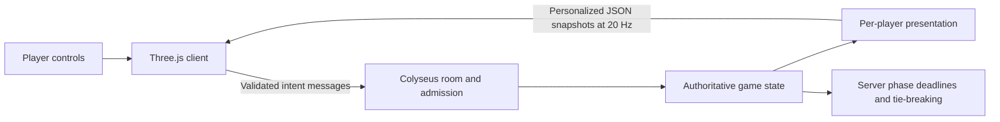

# THE ATRIUM

A procedural 3D multiplayer mystery for 2–4 people. Hide a key in your Clockwork Library, read rivals’ clues, search their universes, and unlock the central portal.

## Authoritative multiplayer architecture

The browser uses Three.js to render a procedural library and Colyseus to exchange player intent with a Node.js server. The [game engine](apps/server/src/game.ts) owns phase transitions, clues, key ownership, round assignments and the winner. Keeping that logic separate from transport makes game rules testable without a browser or WebGL context.



Clients receive personalized views rather than every player's hidden answer. Preparation, one visit per rival and the finale advance against server deadlines; collecting a key twice does not duplicate inventory. Disconnected seats retain their rooms and searchable secrets during the match, and host authority transfers. The rendering client interpolates presentation; it does not decide whether a key was earned or a portal unlocked.

## Admission and session recovery

Server-issued invites carry cryptographically random 256-bit bearer tokens in `#invite=…` fragments. Admission grants, seat identities and recovery tokens are also high-entropy values. Hosts can rotate invites, lock joining and kick seats; kicking rotates the invite. Invites expire after 30 minutes and rooms after one hour. Unexpected disconnects allow a 20-second recovery window; refresh recovery is tab-scoped in sessionStorage. Explicit leave, kick or flooding ends the session. Credentials are kept out of persistent preferences.

Sessions are in memory and disappear on server restart. The current default `development` branch supports 2–4 players and Colyseus 0.17 personalized JSON snapshots, not schema deltas. Server validation, input rate limits and private state projection protect the game boundary. Representative production load and public hosting acceptance require separate verification.

## Run

Requires Node 22.12+ and npm.

```sh
npm ci
npm run dev
```

Open http://localhost:5173. The Colyseus server runs on port 2567. Create a lobby with a nickname, copy the invite, and join from another tab/browser with a different nickname. The host starts with 2–4 players. Development listeners are local only. For staging, use HTTPS/WSS through the reviewed reverse proxy configuration; do not expose either dev port publicly.

Choose Soren or Mara before entering a lobby; Portrait previews the modeled face. Selection is saved locally. WASD moves, Shift runs, the mouse wheel zooms, and R recenters. Hold right mouse and drag to orbit the camera. E inspects the nearest object; in the finale it enters a nearby rival door or unlocks the central portal. The on-screen interaction button also works. Each library has a clock, desk, hollow book, statue, and secret compartment. Interact with the peculiar book along the back wall to slide the shelf aside. In the finale, return using the HUD button.

Preparation lasts 120 seconds or until all rooms are ready. Each exploration round lasts 90 seconds, visiting every rival exactly once. The finale lasts 90 seconds, with explicit hiding-place hints in its second half. All keys are required at the portal. At timeout, keys collected, time of collecting all keys, and original join order break ties. Disconnected players retain their room and count in the match; their secrets remain searchable. The host role transfers. Replay removes disconnected players and clears secrets and keys.

## Checks and short mode

```sh
npm run typecheck
npm test
npm run lint
npm run build
FAST_MODE=1 npm run dev
```

Export variables in your shell; the server does not load `.env` automatically. FAST_MODE is rejected in production.

Short mode uses 1.5s preparation, 2.5s exploration rounds, and a 5s finale. For normal play omit FAST_MODE. `npm run build` outputs the Vite client under `apps/client/dist` and compiled server under `apps/server/dist`. `npm run start -w apps/server` runs the source server with tsx.

Manual browser check: use two tabs, verify names and motion, set different clues, mark both ready, inspect the wrong object, open the hidden shelf, collect one key twice (inventory must remain one), wait for finale, approach center and press E, then replay. In three/four tabs check each round changes owner and never visits your own room.

## Rendering and verification

Local synthesized ambience/effects start after a user gesture; Settings controls graphics, volume and mute. Procedural collision uses axis-aligned major furniture and room boundaries. The implementation targets keyboard/mouse desktop play; mobile controls and accessibility beyond the HUD need additional acceptance.

The server tests separate [game rules](apps/server/src/game.test.ts), [network behavior](apps/server/src/network.test.ts), [personalized presentation](apps/server/src/presentation.test.ts), [admission](apps/server/src/admission.test.ts) and [security](apps/server/src/security.test.ts). The manual checks above complement these tests with rendered interaction. Run `npm run release:check` before release; dependency audit results are time-specific checks, not a permanent security guarantee.

## Art and assets

The game ships local, licensed human GLBs, PBR surfaces/HDR, scanned library props and original audio. Normal startup does not require Blender, asset accounts or asset downloads. See `docs/ART_DIRECTION.md`, `docs/CHARACTER_PIPELINE.md`, `docs/ASSET_CREDITS.md` and `docs/PERFORMANCE.md` for provenance, rebuilding and measured limits.

## Engineering references

[Art direction](docs/ART_DIRECTION.md) · [Character pipeline](docs/CHARACTER_PIPELINE.md) · [Asset credits](docs/ASSET_CREDITS.md) · [Performance evidence](docs/PERFORMANCE.md) · [Security audit](docs/SECURITY_AUDIT.md) · [Security architecture](docs/SECURITY_ARCHITECTURE.md) · [Privacy](docs/PRIVACY.md) · [Deployment security](docs/DEPLOYMENT_SECURITY.md) · [Release checklist](docs/PUBLIC_RELEASE_CHECKLIST.md)

The checked-in reverse proxy and release guidance describe the intended HTTPS/WSS boundary. They do not establish a verified public deployment.

Documentation basis: [`e651d07`](https://github.com/akilanpl/the-atrium/tree/e651d07e3d9670109121d6c95083c797015ff5de). Recorded validation retains its original source and environment scope.
